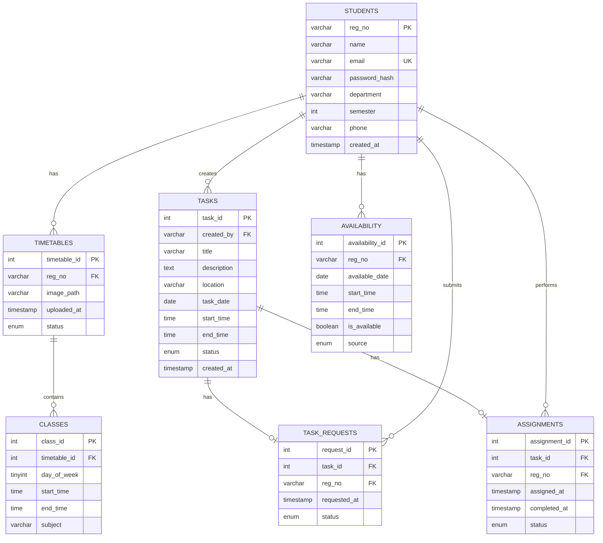

# CampusHelp 🎓

### Student Availability and Campus Parcel Pickup Management System

CampusHelp is a Python and MySQL-based application that helps students coordinate campus parcel pickups based on their laboratory schedules. It calculates students' free intervals and helps assign pickup tasks to students who have enough available time.

---

## Table of Contents

1. [Overview](#1-overview)
2. [Problem Statement](#2-problem-statement)
3. [Objectives](#3-objectives)
4. [Features](#4-features)
5. [Technology Stack](#5-technology-stack)
6. [System Workflow](#6-system-workflow)
7. [Database Design](#7-database-design)
8. [Database Tables](#8-database-tables)
9. [Installation and Setup](#9-installation-and-setup)
10. [Running the Application](#10-running-the-application)
11. [Example Scenario](#11-example-scenario)
12. [Future Enhancements](#12-future-enhancements)
13. [Project Structure](#13-project-structure)
14. [Author](#14-author)

---

## 1. Overview

CampusHelp is designed to make campus parcel collection easier by connecting students who need pickups with students who have suitable free time.

The application stores student information, laboratory timetables, pickup requests, and task assignments in a relational MySQL database. Python handles the application logic, including availability calculations and task management.

The current prototype uses a command-line interface and focuses on laboratory schedules.

## 2. Problem Statement

Students may be unable to collect parcels from campus pickup points because of laboratory sessions or other academic commitments. Meanwhile, other students may have free time but no convenient way to coordinate pickups.

CampusHelp addresses this problem by calculating free intervals from student laboratory schedules and identifying students who can complete a pickup within the required time.

## 3. Objectives

- Store student information using college registration numbers.
- Maintain student timetables and laboratory sessions.
- Calculate free intervals within the 8:00 AM–1:00 PM pickup window.
- Identify intervals that can accommodate a 15-minute pickup.
- Create and manage parcel pickup requests.
- Assign tasks to eligible students.
- Track task and assignment statuses.
- Demonstrate relational database design using primary keys, foreign keys, constraints, and indexes.

## 4. Features

- **Student management:** Stores registration details and account information.
- **Timetable management:** Records individual laboratory sessions.
- **Free-interval calculation:** Finds gaps between labs within the pickup window.
- **Pickup requests:** Stores pickup dates, locations, and descriptions.
- **Eligibility checking:** Identifies students with at least 15 continuous minutes free.
- **Task assignment:** Assigns pickup tasks to eligible students.
- **Assignment tracking:** Displays tasks assigned to a particular student.
- **Relational database:** Uses MySQL to persist application data.

### Availability rules

- The pickup window is 8:00 AM to 1:00 PM.
- A pickup requires at least 15 continuous minutes.
- Gaps of 10 minutes or less between consecutive labs are treated as unavailable.
- Sunday is treated as a day without classes.
- Only laboratory sessions are considered in the current prototype.
- Availability is calculated for the selected pickup date.

## 5. Technology Stack

| Technology | Purpose |
|---|---|
| Python | Application logic and command-line interface |
| MySQL | Relational database |
| MySQL Connector/Python | Connects Python to MySQL |
| VS Code | Development environment |
| Git | Version control |
| GitHub | Source code hosting |

## 6. System Workflow

1. Student details are stored in `students`.
2. A timetable record is created in `timetables`.
3. Individual laboratory sessions are stored in `classes`.
4. CampusHelp calculates free intervals for the selected date.
5. A student creates a parcel pickup request.
6. The system checks which students have sufficient free time.
7. The pickup task is assigned to an eligible student.
8. Assignment and task statuses are stored in MySQL.

---

## 7. Database Design

CampusHelp uses a relational database named `CampusHelp` containing seven tables:

- `students`
- `timetables`
- `classes`
- `tasks`
- `task_requests`
- `assignments`
- `availability`

### Entity Relationship Diagram



### Primary keys

Primary keys uniquely identify records in their respective tables.

| Table | Primary key |
|---|---|
| `students` | `reg_no` |
| `timetables` | `timetable_id` |
| `classes` | `class_id` |
| `tasks` | `task_id` |
| `task_requests` | `request_id` |
| `assignments` | `assignment_id` |
| `availability` | `availability_id` |

The `students.email` column also has a unique constraint. The `task_requests.task_id` and `assignments.task_id` columns are unique, allowing at most one request record and one assignment record per task.

### Foreign-key relationships

| Child table | Foreign key | References |
|---|---|---|
| `timetables` | `reg_no` | `students.reg_no` |
| `classes` | `timetable_id` | `timetables.timetable_id` |
| `tasks` | `created_by` | `students.reg_no` |
| `task_requests` | `task_id` | `tasks.task_id` |
| `task_requests` | `reg_no` | `students.reg_no` |
| `assignments` | `task_id` | `tasks.task_id` |
| `assignments` | `reg_no` | `students.reg_no` |
| `availability` | `reg_no` | `students.reg_no` |

These relationships maintain referential integrity and prevent records from referring to nonexistent students, timetables, or tasks.

---

## 8. Database Tables

### 8.1 `students`

Stores student registration and account information.

| Column | Description |
|---|---|
| `reg_no` | Primary key and college registration number |
| `name` | Student name |
| `email` | Student email address; unique |
| `password_hash` | Hashed password |
| `department` | Academic department |
| `semester` | Current semester |
| `phone` | Contact number |
| `created_at` | Account creation timestamp |

**Purpose:** Identifies students throughout the application. The registration number is used to associate students with their timetables, tasks, assignments, and availability records.

### 8.2 `timetables`

Stores timetable records belonging to students.

| Column | Description |
|---|---|
| `timetable_id` | Primary key |
| `reg_no` | Student registration number; foreign key |
| `image_path` | Optional path to a timetable image |
| `uploaded_at` | Upload timestamp |
| `status` | Timetable processing or verification status |

**Purpose:** Connects a student with a timetable record. Individual laboratory sessions are stored separately in `classes`.

### 8.3 `classes`

Stores individual laboratory sessions.

| Column | Description |
|---|---|
| `class_id` | Primary key |
| `timetable_id` | References `timetables.timetable_id` |
| `day_of_week` | Day identifier from 1 to 7 |
| `start_time` | Lab start time |
| `end_time` | Lab end time |
| `subject` | Lab or subject name |

Day numbering:

| Value | Day |
|---:|---|
| 1 | Sunday |
| 2 | Monday |
| 3 | Tuesday |
| 4 | Wednesday |
| 5 | Thursday |
| 6 | Friday |
| 7 | Saturday |

**Purpose:** Provides the schedule data used to determine when a student is busy and calculate free intervals.

### 8.4 `tasks`

Stores parcel pickup tasks.

| Column | Description |
|---|---|
| `task_id` | Primary key |
| `created_by` | Registration number of the requester |
| `title` | Task title |
| `description` | Pickup details |
| `location` | Pickup location |
| `task_date` | Requested pickup date |
| `start_time` | Optional scheduled start time |
| `end_time` | Optional scheduled end time |
| `status` | Current task status |
| `created_at` | Task creation timestamp |

Task statuses:

- `open`
- `assigned`
- `in_progress`
- `completed`
- `cancelled`

**Purpose:** Stores the main details of each pickup task and tracks its overall progress.

### 8.5 `task_requests`

Stores requests associated with pickup tasks.

| Column | Description |
|---|---|
| `request_id` | Primary key |
| `task_id` | References `tasks.task_id`; unique |
| `requested_at` | Request timestamp |
| `status` | Request status |
| `reg_no` | Student associated with the request |

Request statuses:

- `pending`
- `accepted`
- `declined`
- `withdrawn`

**Purpose:** Tracks the request associated with a task separately from the task itself.

### 8.6 `assignments`

Stores student-task assignments.

| Column | Description |
|---|---|
| `assignment_id` | Primary key |
| `task_id` | References `tasks.task_id`; unique |
| `reg_no` | Registration number of the assigned student |
| `assigned_at` | Assignment timestamp |
| `completed_at` | Completion timestamp |
| `status` | Assignment progress |

Assignment statuses:

- `assigned`
- `in_progress`
- `completed`
- `cancelled`

**Purpose:** Records which student is responsible for performing a pickup and tracks the assignment's progress.

### 8.7 `availability`

Stores availability intervals associated with students.

| Column | Description |
|---|---|
| `availability_id` | Primary key |
| `available_date` | Date of availability |
| `start_time` | Interval start time |
| `end_time` | Interval end time |
| `is_available` | Availability flag |
| `source` | `timetable` or `manual` |
| `reg_no` | Student registration number; foreign key |

**Purpose:** Provides a structure for storing availability intervals, whether derived from a timetable or entered manually. The current availability logic can also calculate intervals directly from `classes`.

---

## 9. Installation and Setup

### Prerequisites

Install the following:

- Python 3
- MySQL Server
- Git

### Step 1: Clone the repository

```bash
git clone https://github.com/vaii7x/CampusHelp.git
cd CampusHelp
```

### Step 2: Create a virtual environment

On Windows PowerShell:

```powershell
python -m venv .venv
.venv\Scripts\Activate.ps1
```

### Step 3: Install dependencies

```bash
pip install -r requirements.txt
```

### Step 4: Create the database

The repository includes [`schema.sql`](schema.sql), which creates the `CampusHelp` database and its seven tables.

Run the script from the project directory using a MySQL command-line client:

```bash
mysql -u root -p < schema.sql
```

Enter your MySQL password when prompted.

**Important:** This script creates an empty database structure. It does not import existing student records or timetable data. Run it against a fresh database; `CREATE TABLE IF NOT EXISTS` does not modify tables that already exist.

### Step 5: Configure the database connection

Open `database.py` and configure the local MySQL connection settings.

Use your own MySQL username, password, host, and database name. Do not publish credentials in the repository.

### Step 6: Start the application

```bash
python main.py
```

---

## 10. Running the Application

The application provides a command-line menu for the supported operations.

Depending on the current menu, users can:

1. Register a student.
2. Enter or update a timetable.
3. Check student availability.
4. Manage pickup tasks.
5. View pickup requests and assignments.

To check a student's availability, enter the college registration number and select the relevant operation.

To view assigned tasks, enter the registration number of the student whose assignments you want to inspect.

---

## 11. Example Scenario

Suppose a student has a laboratory session from 9:50 AM to 11:30 AM on Monday.

The pickup window is 8:00 AM–1:00 PM.

The system calculates:

| Interval | Duration | Pickup eligible? |
|---|---:|---|
| 8:00–9:50 AM | 110 minutes | Yes |
| 9:50–11:30 AM | Lab session | No |
| 11:30 AM–1:00 PM | 90 minutes | Yes |

Both free intervals can accommodate a 15-minute pickup.

If a student has only a 10-minute gap between consecutive labs, that gap is treated as unavailable.

---

## 12. Future Enhancements

- Automatically extract laboratory sessions from timetable images.
- Add a graphical web interface.
- Implement role-based authentication.
- Support student acceptance and rejection of assignments.
- Add pickup completion verification.
- Prevent overlapping pickup commitments.
- Add automated unit and integration tests.
- Generate reports for pickup requests and task completion.
- Improve availability management and synchronization.

---

## 13. Project Structure

```text
CampusHelp/
├── main.py
├── database.py
├── timetable.py
├── availability.py
├── tasks.py
├── requirements.txt
├── schema.sql
├── README.md
└── .gitignore
```

The Python modules handle application logic, while `schema.sql` defines the database structure.

---

## 14. Author

**Vaishnav Vinod**

GitHub: [@vaii7x](https://github.com/vaii7x)

Repository: [CampusHelp](https://github.com/vaii7x/CampusHelp)

---

*CampusHelp — Making campus parcel pickups easier through student availability and coordination.*
